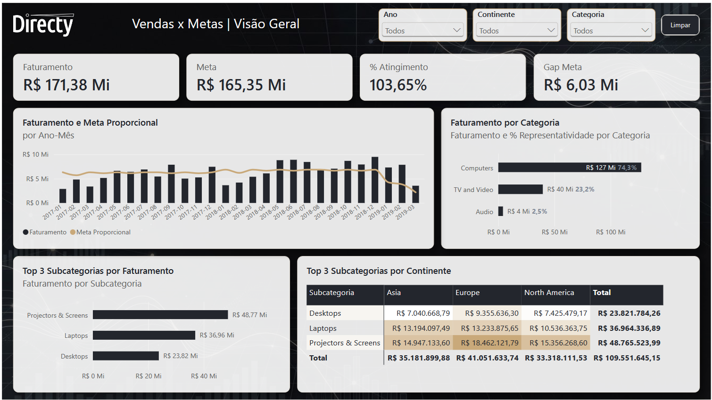
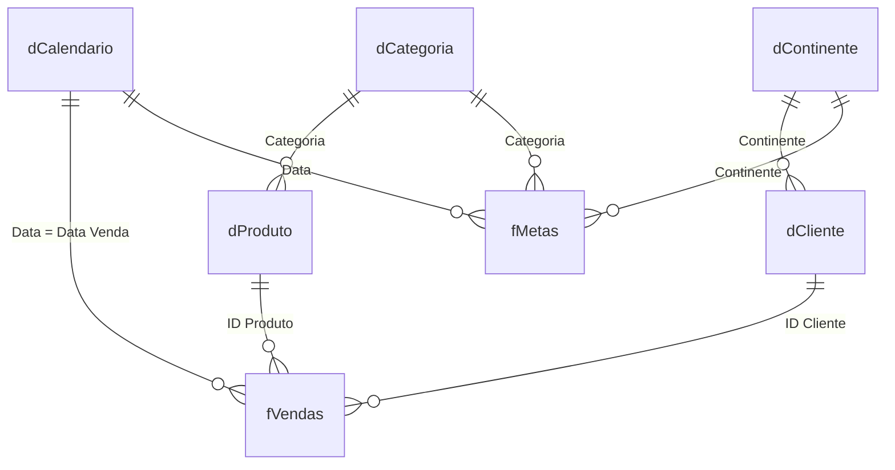
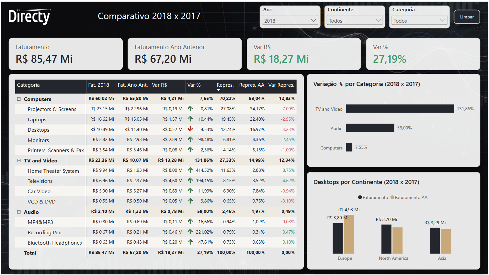
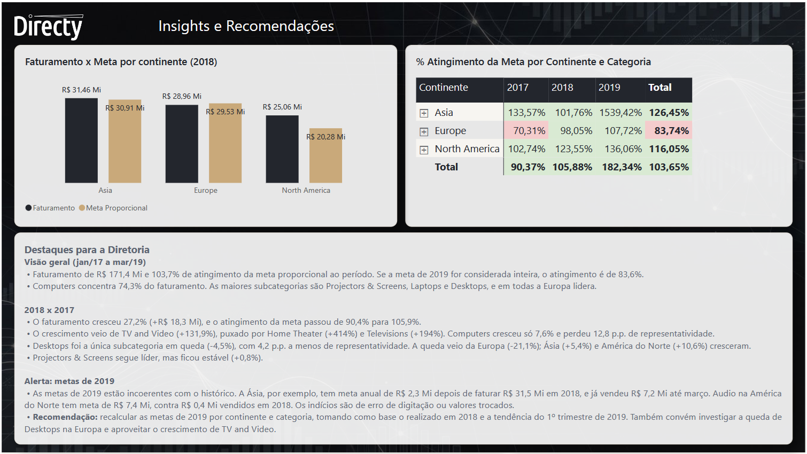
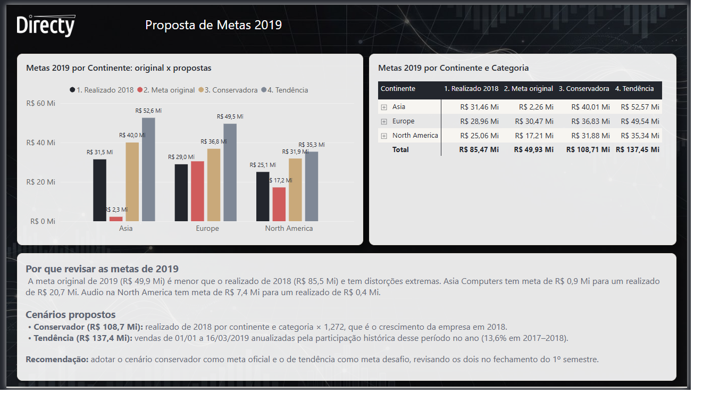

# Análise de Vendas x Metas | Desafio Técnico Directy

Dashboard em **Power BI** para analisar a evolução do faturamento, compará-lo com as metas estabelecidas e comparar 2018 com 2017. O objetivo é apoiar o Diretor e os gestores regionais na revisão das metas de 2019.

**Período dos dados:** 01/01/2017 a 16/03/2019 · **Autor:** Jaderson

[](https://github.com/jsfalcao/desafio-directy-vendas-metas/actions/workflows/validacao.yml)

> ### Resumo executivo
> - **R$ 171,4 Mi** faturados no período, **103,7%** da meta proporcional.
> - **2018 cresceu 27,2%** sobre 2017, puxado por **TV and Video (+131,9%)**. **Desktops** foi a única subcategoria em queda, causada pela **Europa (−21,1%)**.
> - As **metas de 2019 são incoerentes** com o histórico (ex.: Asia com meta anual de R$ 2,3 Mi após faturar R$ 31,5 Mi em 2018).
> - Entrego uma **[proposta de metas 2019](#proposta-de-metas-2019)** com dois cenários: **R$ 108,7 Mi** (conservador) e **R$ 137,4 Mi** (tendência), contra R$ 49,9 Mi da meta original.



---

## Sumário
1. [Estrutura do repositório](#estrutura-do-repositório)
2. [Como abrir o relatório](#como-abrir-o-relatório)
3. [ETL: tratamento dos dados](#etl-tratamento-dos-dados)
4. [Modelo de dados](#modelo-de-dados)
5. [Medidas DAX](#medidas-dax)
6. [Decisões técnicas](#decisões-técnicas)
7. [Premissas](#premissas)
8. [Páginas do dashboard](#páginas-do-dashboard)
9. [Respostas às perguntas do case](#respostas-às-perguntas-do-case)
10. [Insights e recomendações](#insights-e-recomendações)
11. [Proposta de metas 2019](#proposta-de-metas-2019)
12. [Validação independente e automação](#validação-independente-e-automação)

---

## Estrutura do repositório

```
├── powerbi/
│   ├── Vendas_x_Metas.pbix          ← relatório Power BI
│   └── Tema_Directy_Claro.json      ← tema com a identidade visual Directy
├── dados/                           ← arquivos originais do desafio
├── powerquery/consultas_power_query.m   ← código M de todas as consultas
├── dax/medidas.dax                  ← tabela calendário e todas as medidas
├── validacao/
│   ├── validacao.py                 ← conferência dos números em Python
│   └── proposta_metas_2019.py       ← cálculo da proposta de metas 2019
├── .github/workflows/validacao.yml  ← execução automática da validação (GitHub Actions)
└── docs/
    ├── Enunciado - Desafio Vendas x Metas.pdf  ← enunciado do case
    ├── Vendas_x_Metas.pdf           ← exportação do relatório
    ├── proposta_metas_2019.csv      ← proposta de metas por continente e categoria
    └── prints/                      ← imagens das páginas
```

## Como abrir o relatório

1. Baixe o repositório e abra `powerbi/Vendas_x_Metas.pbix` no Power BI Desktop.
2. Para atualizar os dados, altere o parâmetro **PastaDados** (*Transformar dados → Gerenciar parâmetros*) para o caminho local da pasta `dados/`, terminando com `\`.
3. Clique em **Atualizar**.

---

## ETL: tratamento dos dados

Os arquivos de origem vieram em formatos e estruturas diferentes. Todo o tratamento foi feito no **Power Query** (código completo em [`powerquery/consultas_power_query.m`](powerquery/consultas_power_query.m)):

| Arquivo | Problema encontrado | Tratamento |
|---|---|---|
| `Vendas.xlsx` | 5 linhas de título antes do cabeçalho; não traz *Valor Venda* nem *Valor Custo* | Remoção dinâmica das linhas até o cabeçalho; criação de **Valor Venda = Preço Unitário × Quantidade − Desconto** e **Valor Custo = Custo Unitário × Quantidade** |
| `Cliente.xlsx` | Clientes *Person* (nome + sobrenome) e *Company* (nome da empresa); sem localização, só o ID da cidade | Coluna **Nome** condicional pelo tipo; mesclagem com a Localização |
| `Localizacao.csv` | Separador `;`; continente como **linha de agrupamento**; valores `NULL` em texto; mistura de país, estado e cidade | Coluna Continente com **preenchimento para baixo**; filtro apenas das linhas de cidade |
| `Produto.csv` | Marca como **linha de agrupamento**; ID e nome concatenados (`Produto # 116 - ...`) | Preenchimento para baixo da Marca; extração dos IDs de produto e subcategoria |
| `Subcategoria.json` | Formato JSON | Conversão em tabela; fornece a Categoria de cada subcategoria |
| `Metas.xlsx` | 3 abas (uma por ano) em **matriz** Categoria × Continente, com linha de Total | Função que trata cada aba, remove o Total e faz o **unpivot**; criação da Data (01/01/ano) |

**Qualidade dos dados verificada:** 70.055 vendas sem nulos ou duplicadas; todas as chaves (produto, cliente, cidade, subcategoria) encontram correspondência nos cadastros.

## Modelo de dados

Modelo em **esquema estrela**, com duas tabelas fato de granularidades diferentes:



- **fVendas**: granularidade diária, por produto e cliente.
- **fMetas**: granularidade anual, por continente e categoria.
- **dCategoria** e **dContinente** são dimensões "ponte": um único filtro de categoria ou continente age **ao mesmo tempo** sobre vendas e metas.
- **dCalendario** foi criada em DAX e marcada como tabela de datas, para as funções de inteligência de tempo.

## Medidas DAX

Código completo em [`dax/medidas.dax`](dax/medidas.dax). Principais medidas:

| Medida | Descrição |
|---|---|
| `Faturamento` | Soma do Valor Venda (líquido de desconto) |
| `Meta` | Soma da meta; fica **em branco** em níveis em que a meta não existe (subcategoria, produto, cliente), para não exibir números enganosos |
| `Meta Proporcional` | Meta anual distribuída pelos dias do período e limitada à última venda (16/03/2019); permite comparar 2019 parcial e exibir a meta por mês |
| `% Atingimento` / `Gap Meta` | Faturamento ÷ Meta Proporcional / Faturamento − Meta Proporcional |
| `Faturamento AA`, `Var R$`, `Var %` | Comparativo com o ano anterior (`SAMEPERIODLASTYEAR`) |
| `% Representatividade`, `% Repres. AA`, `Var Repres. (p.p.)` | Participação no total e sua variação em pontos percentuais |
| `Lucro`, `% Margem`, `Ranking Subcategoria` | Medidas complementares |
| `Valor Cenário` | Valores da proposta de metas 2019 (tabela `fMetasProposta`, importada de `docs/proposta_metas_2019.csv`) |

## Decisões técnicas

| Decisão | Por quê |
|---|---|
| **Dimensões ponte** `dCategoria` e `dContinente` | Vendas e metas têm granularidades diferentes (diária por produto e cliente x anual por continente e categoria). As pontes permitem que **um único filtro** atue nas duas fatos, sem relações bidirecionais nem ambiguidade no modelo. |
| **Meta em branco** abaixo da granularidade da meta | Não existe meta por subcategoria, produto ou cliente. Repetir a meta da categoria nesses níveis induziria a erro, então a medida retorna vazio (`ISFILTERED`). |
| **Meta Proporcional** por dias | 2019 tem só 75 dias de vendas. Comparar com a meta anual cheia distorce o atingimento. A distribuição diária também permite exibir a meta mês a mês. |
| **Valor Venda líquido de desconto** | Representa a receita efetivamente faturada. |
| **ETL 100% no Power Query**, sem tratar os arquivos na mão | O processo é reprodutível: basta substituir os arquivos de origem e atualizar. Remoção de cabeçalhos por condição, e não por número fixo de linhas, para tolerar mudanças no layout. |
| **Validação independente em Python** e **GitHub Actions** | Os números do dashboard são recalculados por outro caminho e conferidos automaticamente a cada atualização do repositório. |

## Premissas

1. **Faturamento** = Preço Unitário × Quantidade − Valor Desconto, ou seja, líquido de desconto.
2. **Meta do período:** como 2019 tem vendas só até 16/03, a meta de 2019 foi considerada **proporcional aos 75 dias decorridos** (75/365). Para referência, o README também traz o resultado com a meta anual cheia.
3. A meta foi distribuída **linearmente** ao longo do ano para a visão mensal, já que não há sazonalidade definida nas metas.
4. Nos visuais, Categoria e Continente vêm das dimensões ponte (`dCategoria`, `dContinente`), para que a meta seja filtrada corretamente.

## Páginas do dashboard

| Página | Conteúdo |
|---|---|
| **1. Visão Geral** | KPIs (Faturamento, Meta, % Atingimento, Gap); evolução mensal Faturamento x Meta; faturamento e representatividade por categoria; Top 3 subcategorias e sua distribuição por continente |
| **2. Comparativo 2018 x 2017** | KPIs com variação; matriz por categoria e subcategoria com variação e representatividade; variação % por categoria; Desktops por continente |
| **3. Insights e Recomendações** | Faturamento x Meta por continente; mapa de calor de % atingimento por ano, continente e categoria; destaques para a diretoria |
| **4. Proposta de Metas 2019** | Realizado 2018 x meta original x cenários propostos (conservador e tendência) por continente e categoria, com metodologia e recomendação |





---

## Respostas às perguntas do case

### Exploratória

| # | Pergunta | Resposta |
|---|---|---|
| 1 | Faturamento de todo o período | **R$ 171.377.435,74** |
| 2 | Meta de faturamento do período | **R$ 165.350.068,16** (meta de 2019 proporcional até 16/03). Com a meta anual de 2019 cheia: R$ 205.023.845,01 |
| 3 | % de atendimento da meta | **103,65%** (sobre a meta cheia: 83,59%) |
| 4 | Categoria com maior faturamento | **Computers**: R$ 127.387.254,64 |
| 5 | Representatividade dessa categoria | **74,33%** do faturamento total |
| 6 | 3 subcategorias com maior faturamento | **Projectors & Screens** (R$ 48,77 Mi), **Laptops** (R$ 36,96 Mi), **Desktops** (R$ 23,82 Mi) |
| 7 | Continentes nessas 3 subcategorias (maior → menor) | **Europe** (R$ 41,05 Mi) → **Asia** (R$ 35,18 Mi) → **North America** (R$ 33,32 Mi) |

### Comparativo entre os anos

| # | Pergunta | Resposta |
|---|---|---|
| 8 | Variação do faturamento 2018 x 2017 | **+R$ 18.273.196,28 (+27,19%)**: de R$ 67,20 Mi para R$ 85,47 Mi |
| 9 | A variação foi positiva em todas as subcategorias? | **Não.** **Desktops** foi a única subcategoria com queda: −4,53% (−R$ 516.430,66) |
| 10 | Variação de representatividade de Desktops | De 16,97% para 12,74%: **−4,23 p.p.** (queda relativa de 24,9%) |
| 11 | Continente responsável pela queda em Desktops | **Europe**: −R$ 1.040.236,87 (−21,08%). Asia (+5,45%) e North America (+10,58%) cresceram |
| 12 | Categoria com maior faturamento em 2018 | **Computers**: **R$ 60.015.300,44** |
| 13 | Categoria com maior variação % | **TV and Video**: **+131,86%** |
| 14 | 3 subcategorias com maior faturamento em 2018 | **Projectors & Screens** (R$ 23,15 Mi), **Laptops** (R$ 16,62 Mi), **Desktops** (R$ 10,89 Mi) |
| 15 | São as mesmas do período total? | **Sim**: as mesmas três, na mesma ordem |

---

## Insights e recomendações

**Visão geral**
- O faturamento do período (R$ 171,4 Mi) supera a meta proporcional em 3,65%.
- **Computers concentra 74,3%** do faturamento, uma dependência relevante de uma única categoria.

**2018 x 2017**
- O faturamento cresceu **27,2%**, e o atingimento da meta subiu de **90,4%** (2017) para **105,9%** (2018).
- O crescimento foi puxado por **TV and Video (+131,9%)**, com destaque para **Home Theater System (+414%)** e **Televisions (+194%)**. Computers cresceu só 7,6% e perdeu 12,8 p.p. de participação.
- **Desktops** foi a única subcategoria em queda, causada **inteiramente pela Europa** (−21,1%). É um ponto a investigar com o gestor regional.
- **Projectors & Screens** segue líder, mas ficou praticamente estável (+0,8%).
- Em 2017 a Europa atingiu só 70,3% da meta. Em 2018, com as metas rebalanceadas entre os continentes, todos ficaram próximos ou acima de 100%.

**⚠️ Alerta: metas de 2019**
- As metas de 2019 são **incoerentes com o histórico** e indicam erro de digitação ou valores trocados:
  - **Asia**: meta anual de R$ 2,26 Mi, depois de faturar R$ 31,5 Mi em 2018. Até 16/03 já faturou R$ 7,2 Mi, o que dá 1.539% da meta proporcional.
  - **Audio na North America**: meta de R$ 7,39 Mi, contra R$ 0,4 Mi faturados em 2018.
- **Recomendação:** recalcular as metas de 2019 por continente e categoria, tomando como base o realizado em 2018 e a tendência do 1º trimestre de 2019. Também convém aproveitar o crescimento de TV and Video e tratar a queda de Desktops na Europa.

---

## Proposta de metas 2019

Como as metas originais de 2019 não são compatíveis com o histórico, proponho dois cenários, apresentados também na **página 4 do dashboard** por continente e categoria (detalhes em [`docs/proposta_metas_2019.csv`](docs/proposta_metas_2019.csv), cálculo em [`validacao/proposta_metas_2019.py`](validacao/proposta_metas_2019.py)):

- **Conservador:** realizado de 2018 × (1 + crescimento da empresa em 2018, **27,19%**). Mantém o mix de 2018 e o ritmo de crescimento já comprovado.
- **Tendência:** realizado de 01/01 a 16/03/2019 ÷ **13,61%**, a participação média desse mesmo período no faturamento anual de 2017 e 2018. Projeta o ano com o ritmo atual, respeitando a sazonalidade histórica.

| Continente | Categoria | Realizado 2018 | Meta original 2019 | Proposta conservadora | Proposta tendência |
|---|---|---:|---:|---:|---:|
| Asia | Audio | R$ 0,87 Mi | R$ 1,02 Mi | R$ 1,11 Mi | R$ 2,86 Mi |
| Asia | Computers | R$ 20,67 Mi | R$ 0,92 Mi ⚠️ | R$ 26,29 Mi | R$ 28,22 Mi |
| Asia | TV and Video | R$ 9,91 Mi | R$ 0,32 Mi ⚠️ | R$ 12,61 Mi | R$ 21,48 Mi |
| Europe | Audio | R$ 0,85 Mi | R$ 7,95 Mi ⚠️ | R$ 1,08 Mi | R$ 2,27 Mi |
| Europe | Computers | R$ 19,48 Mi | R$ 11,56 Mi | R$ 24,78 Mi | R$ 29,10 Mi |
| Europe | TV and Video | R$ 8,62 Mi | R$ 10,96 Mi | R$ 10,96 Mi | R$ 18,17 Mi |
| North America | Audio | R$ 0,38 Mi | R$ 7,39 Mi ⚠️ | R$ 0,48 Mi | R$ 1,00 Mi |
| North America | Computers | R$ 19,86 Mi | R$ 7,42 Mi | R$ 25,26 Mi | R$ 27,66 Mi |
| North America | TV and Video | R$ 4,82 Mi | R$ 2,40 Mi | R$ 6,13 Mi | R$ 6,68 Mi |
| **Total** | | **R$ 85,47 Mi** | **R$ 49,93 Mi** | **R$ 108,71 Mi** | **R$ 137,45 Mi** |

⚠️ Metas com distorção extrema em relação ao realizado de 2018: menos de 10% ou mais de 9 vezes o valor.

**Recomendação:** adotar o **cenário conservador como meta oficial** e o de **tendência como meta desafio**, revisando as duas após o fechamento do 1º semestre. O 1º trimestre é uma amostra curta e mostra uma aceleração forte (+68% sobre o mesmo período de 2018), especialmente na Asia.

---

## Validação independente e automação

Para garantir a consistência dos números, o tratamento foi reproduzido em Python e as respostas foram recalculadas de forma independente do Power BI. O script compara os resultados com os valores exibidos no dashboard e falha se houver qualquer divergência:

```bash
pip install pandas openpyxl
python validacao/validacao.py
python validacao/proposta_metas_2019.py
```

O workflow do **GitHub Actions** ([`.github/workflows/validacao.yml`](.github/workflows/validacao.yml)) roda essa validação automaticamente a cada atualização do repositório. O selo no topo da página mostra o resultado da última execução.
